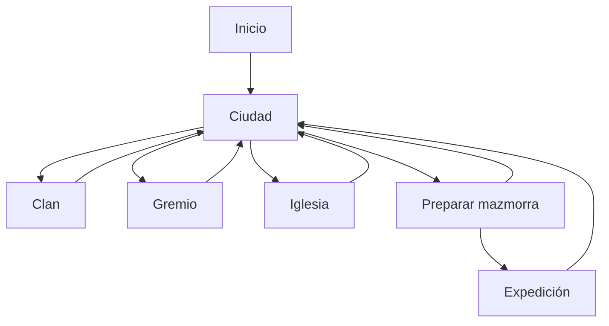

# Diseño: interfaz básica y funcional de Gestión de Clan ENOM

## Intención

Crear la primera versión visual y demostrable del proyecto mediante Tkinter.
La interfaz debe permitir utilizar, de principio a fin, todos los sistemas que
ya existen: crear o continuar una partida, administrar el clan, reclutar,
gestionar la iglesia, formar un grupo y completar o abandonar una expedición a
la Mazmorra de los Limos.

Esta etapa prioriza la claridad y el funcionamiento. La presentación visual
definitiva con fondos, retratos, edificios e iconos se incorporará después de
implementar las habilidades profesionales.

## Objetivos

- Iniciar el programa desde `main.py` y abrir una única ventana de Tkinter.
- Crear una partida nueva, continuar una existente o salir.
- Mantener en memoria un único estado de sesión fuertemente tipado.
- Navegar entre pantallas sin abrir ventanas principales duplicadas.
- Mostrar el nombre, nivel, dinero y ocupación del clan.
- Consultar y expulsar integrantes vivos con las protecciones existentes.
- Consultar ofertas y contratar aventureros.
- Consultar cuerpos, resucitarlos, enterrarlos y mostrar el memorial.
- Seleccionar aventureros vivos e iniciar la Mazmorra de los Limos.
- Resolver una oleada por vez y mostrar su resultado sin animaciones.
- Permitir continuar o retirarse cuando el flujo de expedición lo admita.
- Cerrar la expedición, guardar sus consecuencias y volver a la ciudad.
- Convertir las excepciones controladas en mensajes comprensibles.
- Conservar la separación entre interfaz, coordinación y reglas de dominio.

## Fuera de alcance

- Las quince habilidades profesionales y sus enfriamientos.
- Las mazmorras de dificultad 2 a 5.
- El ascenso del clan y la condición de victoria de nivel 5.
- Fondos de ciudad, retratos, iconos y botones con imágenes.
- Sonidos, música, animaciones o esperas artificiales.
- Historial detallado de cada ataque de una ronda.
- Guardar o reanudar una expedición que quedó a mitad de camino.
- Varias partidas guardadas o perfiles de jugadores.
- Rediseñar los servicios de dominio que ya están implementados.

## Enfoques considerados

### Una ventana con pantallas intercambiables — seleccionado

La aplicación utiliza una sola instancia de `tk.Tk`. Cada sección es un
`ttk.Frame` y `AplicacionClan` reemplaza la pantalla visible al navegar. Los
mensajes y confirmaciones breves utilizan `messagebox`.

Este enfoque centraliza el estado, evita ventanas duplicadas y permite
reemplazar en el futuro la ciudad provisional por una ciudad ilustrada sin
cambiar los servicios.

### Varias ventanas `Toplevel`

Se descartó porque obliga a sincronizar datos entre ventanas, controlar cierres
fuera de orden y evitar que una misma sección se abra varias veces.

### Una pantalla reconstruida manualmente

Se descartó porque mezclaría todos los widgets y eventos en un único módulo,
dificultando las pruebas, el mantenimiento y el posterior rediseño visual.

## Restricciones

- Python 3.11 o superior.
- Solo biblioteca estándar; Tkinter y `ttk` sin dependencias externas.
- Anotaciones compatibles con Pyright en modo `strict`.
- Los servicios no importarán Tkinter ni mostrarán ventanas.
- Las pantallas no duplicarán reglas de economía, combate o validación.
- Toda decisión aleatoria reutilizará una instancia de `Random` de la sesión.
- Solo habrá una expedición activa.
- Los archivos JSON conservarán su esquema actual.
- El programa debe ser utilizable en 1366 × 768 y 1920 × 1080.
- La interfaz se probará visualmente en Windows, pero las pruebas automatizadas
  no dependerán de disponer de un servidor gráfico.

## Arquitectura general

```text
main.py
  └── AplicacionClan
        ├── EstadoSesion
        ├── pantalla actual
        ├── navegación
        ├── diálogos
        └── coordinación de guardado
              ├── servicios de dominio
              └── persistencia JSON
```

`AplicacionClan` será el único coordinador visual. No contendrá fórmulas ni
reglas del juego: recibirá acciones de las pantallas, llamará al servicio
correspondiente, guardará cuando haga falta y decidirá la siguiente pantalla.

## Estado de sesión

La sesión utilizará una estructura tipada propia de la capa de aplicación:

```python
@dataclass
class EstadoSesion:
    estado_clan: EstadoClan | None = None
    datos_activos: list[AventureroActivo] = field(default_factory=list)
    datos_eliminados: list[AventureroEliminado] = field(default_factory=list)
    expedicion: EstadoExpedicion | None = None
```

La ausencia de `estado_clan` representa que todavía no se creó ni cargó una
partida. La expedición solo tendrá valor mientras el jugador se encuentre en
la pantalla de combate.

`AplicacionClan` también conservará:

- la instancia raíz de `Tk`;
- una única instancia de `Random`;
- el directorio de la partida, inyectable para pruebas;
- la pantalla actualmente visible.

No se crearán variables globales con la partida activa.

## Navegación

La aplicación creará una pantalla nueva al navegar y destruirá la anterior.
Así, cada pantalla leerá siempre el estado actualizado y no conservará widgets
obsoletos.



Durante una expedición no habrá un botón para volver libremente a la ciudad.
El jugador deberá retirarse en un punto válido o terminar automáticamente por
victoria, derrota o límite de rondas.

## Ventana principal

- Título: `Gestión de Clan ENOM`.
- Tamaño inicial aproximado: 1100 × 700.
- Tamaño mínimo aproximado: 900 × 600.
- Los contenedores usarán `grid()` con expansión mediante pesos de filas y
  columnas.
- Los listados extensos utilizarán `Listbox`, `Treeview` o `ScrolledText` según
  corresponda.
- Cerrar la ventana durante una expedición mostrará una advertencia porque el
  progreso temporal se perderá.
- Fuera de una expedición, cerrar la ventana no requiere un guardado adicional:
  cada operación persistente ya habrá sido guardada al finalizar.

## Pantalla de inicio

Controles:

- título del juego;
- campo para el nombre del clan;
- botón `Nueva partida`;
- botón `Continuar`;
- botón `Salir`;
- texto breve de estado o error.

### Nueva partida

1. Normaliza y valida el nombre mediante el servicio existente.
2. Si existe una partida válida, solicita confirmación para sobrescribirla.
3. Si la partida está incompleta o dañada, informa el problema y ofrece borrar
   exclusivamente los tres JSON conocidos mediante una confirmación explícita.
4. Llama a `crear_nueva_partida()` y publica el resultado en la sesión.
5. Navega a la ciudad.

### Continuar

1. Comprueba que exista una partida válida.
2. Llama a `cargar_partida()`.
3. Publica las tres estructuras en la sesión.
4. Si la partida sigue `en_curso`, navega a la ciudad.
5. Si la partida ya terminó, muestra su resultado y permanece en el inicio
   para permitir crear una partida nueva.

Si no existen archivos, `Continuar` permanece deshabilitado. Una partida
inválida nunca se reemplaza ni elimina sin confirmación del jugador.

## Ciudad provisional

La ciudad será por ahora un menú textual con botones grandes:

- `Clan`;
- `Gremio de aventureros`;
- `Iglesia`;
- `Mazmorra`;
- `Guardar y salir al inicio`.

En la parte superior mostrará:

- nombre del clan;
- nivel;
- dinero;
- integrantes ocupando cupo y cupo total;
- cantidad de integrantes vivos y muertos recuperados;
- estado general de la partida.

Esta pantalla será sustituible más adelante por el fondo ilustrado de la
ciudad y edificios clicables.

## Pantalla del clan

Mostrará exclusivamente los integrantes vivos en una tabla con:

- ID;
- nombre;
- raza;
- profesión;
- nivel;
- experiencia.

Acciones:

- actualizar la selección;
- expulsar al seleccionado con confirmación;
- volver a la ciudad.

La expulsión reutilizará el servicio existente y conservará la protección que
impide expulsar al último integrante vivo.

## Pantalla del gremio

Mostrará:

- dinero disponible;
- ocupación del clan;
- contrataciones restantes;
- ofertas actuales con ID, nombre, raza, profesión, nivel y coste.

Acciones:

- contratar la oferta seleccionada;
- volver a la ciudad.

Después de contratar se actualizarán la tabla y los indicadores. El mercado no
se renovará manualmente: solo se reemplaza después de una expedición, según la
regla ya implementada.

## Pantalla de la iglesia

Contendrá dos secciones simples:

### Cuerpos recuperados

Tabla con ID, nombre, raza, profesión, nivel y coste de resurrección.

Acciones:

- resucitar al seleccionado;
- enterrar con honores al seleccionado;
- volver a la ciudad.

Ambas acciones requerirán confirmación. La falta de dinero o un ID inválido se
mostrará mediante un mensaje sin cambios parciales.

### Memorial

Listado de aventureros enterrados y caídos no recuperados, con su motivo de
baja traducido a texto comprensible.

## Preparación de la mazmorra

Mostrará:

- la Mazmorra de los Limos como única opción habilitada;
- dificultad y cantidad de oleadas;
- tabla de aventureros vivos;
- selección múltiple para formar el grupo;
- límite del grupo según el nivel del clan;
- botones `Iniciar expedición` y `Volver`.

La lista entregará los IDs seleccionados, en su orden visible, a
`iniciar_expedicion()`. La interfaz no replicará las validaciones de integrantes
vivos, duplicados o cantidad máxima; solo mostrará el error controlado del
servicio.

## Pantalla de expedición

No mostrará animaciones ni resolverá ataques individualmente. Tendrá:

- nombre de la mazmorra;
- próxima oleada y oleadas superadas;
- dinero y experiencia provisionales;
- estado de los aventureros y su vida actual;
- un área de texto para el resultado más reciente;
- botones contextuales.

### Estado `lista_para_oleada`

Se habilita únicamente `Resolver oleada`. Al pulsarlo se ejecuta el combate
completo de esa oleada y se muestra:

- victoria, derrota o límite;
- cantidad de rondas;
- enemigos derrotados;
- experiencia base obtenida;
- dinero bonificado agregado;
- vida y estado de cada aventurero.

### Estado `esperando_decision`

Se habilitan:

- `Continuar`;
- `Retirarse`.

### Estado `finalizada`

La aplicación llama a `cerrar_expedicion_y_guardar()`. Después muestra un
resumen con:

- resultado final;
- dinero entregado;
- experiencia por superviviente;
- IDs de supervivientes y muertos;
- indicación de mazmorra completada;
- estado final de la partida.

Al aceptar el resumen, limpia la expedición temporal y vuelve a la ciudad. Si
el guardado falla, la pantalla permanece disponible para reintentar el cierre
sin duplicar recompensas ni renovar el mercado de otra manera.

Si el cierre deja `estado_partida` en `derrota` o `victoria`, se muestra el
cartel final correspondiente, se limpia la sesión activa y se vuelve al inicio
en lugar de habilitar nuevamente la ciudad.

## Guardado de operaciones administrativas

Los servicios de clan, gremio e iglesia modifican estructuras en memoria pero
no guardan archivos. La aplicación no debe modificar primero el estado público
y guardar después, porque un fallo dejaría memoria y disco desincronizados.

Para cada operación administrativa:

1. crea copias profundas del clan y de ambas listas;
2. ejecuta el servicio sobre las copias;
3. guarda las copias mediante `guardar_partida()`;
4. solo después del éxito publica las copias en `EstadoSesion`;
5. si falla, conserva intacto el estado anterior y muestra el error.

Esta coordinación se implementará en una función genérica y tipada de la capa
de aplicación. El cierre de expedición seguirá usando
`cerrar_expedicion_y_guardar()`, que ya ofrece esa garantía.

## Componentes reutilizables

`interfaz/componentes.py` reunirá únicamente elementos visuales o funciones de
presentación compartidas, por ejemplo:

- encabezado de pantalla;
- barra de resumen del clan;
- botón uniforme de regreso;
- tabla con barra de desplazamiento;
- traducción de motivos y resultados a texto visible;
- formateo de aventureros, ofertas y resultados.

No contendrá reglas ni modificará la partida.

## Errores y mensajes

La interfaz distinguirá como mínimo:

- validación de nombre o selección;
- dinero insuficiente;
- cupo completo;
- último aventurero vivo;
- partida ausente, incompleta o inválida;
- error de lectura o escritura;
- transición inválida de expedición;
- derrota definitiva.

Los errores esperables se mostrarán con `messagebox.showwarning()` o
`messagebox.showerror()`. Las operaciones correctas importantes usarán
`showinfo()`. No se mostrará un traceback al jugador.

Un error inesperado no será absorbido silenciosamente: la aplicación mostrará
un mensaje general y conservará el traceback para desarrollo mediante el
manejador normal de Python.

## Tipado y dependencias entre módulos

- `interfaz/aplicacion.py`: `EstadoSesion`, `AplicacionClan`, navegación,
  coordinación de sesión y guardado.
- `interfaz/inicio.py`: pantalla inicial.
- `interfaz/ciudad.py`: menú principal y resumen.
- `interfaz/clan.py`: consulta y expulsión.
- `interfaz/gremio.py`: ofertas y contratación.
- `interfaz/iglesia.py`: cuerpos, resurrección, entierro y memorial.
- `interfaz/mazmorra.py`: selección de grupo e inicio.
- `interfaz/combate.py`: oleadas, decisiones y cierre.
- `interfaz/componentes.py`: widgets y presentación compartida.
- `main.py`: creación de `Tk`, construcción de la aplicación y `mainloop()`.

Cada módulo de pantalla definirá una clase `ttk.Frame`, por ejemplo
`PantallaInicio`, `PantallaCiudad` y `PantallaClan`. Las pantallas recibirán la
instancia de `AplicacionClan` y solo importarán su tipo dentro de
`TYPE_CHECKING`. El controlador podrá importar y construir las pantallas en
tiempo de ejecución sin formar un ciclo. Ninguna pantalla importará o abrirá
directamente otra pantalla.

## Estrategia de pruebas

### Automatizadas sin servidor gráfico

- construcción y reemplazo del estado de sesión;
- guardado transaccional de una operación administrativa;
- conservación del estado ante fallo del servicio o del JSON;
- traducción y formateo de datos para las tablas;
- decisiones de navegación derivadas del estado;
- coordinación de inicio y cierre de expedición mediante dobles de pantalla.

### Manuales en Windows

- creación de partida y confirmación de sobrescritura;
- continuación después de cerrar y abrir el programa;
- navegación por todas las pantallas;
- contratación, expulsión, resurrección y entierro;
- selección de grupos en los límites permitidos;
- retirada, derrota, límite y finalización de las diez oleadas;
- cierre de ventana durante una expedición;
- legibilidad en 1366 × 768 y 1920 × 1080.

## Correcciones previas de calidad

Antes de construir la interfaz se corregirán los dos errores globales de
Pyright ya registrados:

- la reexportación explícita de `AventureroNoEncontradoError` desde iglesia;
- la firma incompatible del generador controlado de pruebas de reclutamiento.

La interfaz comenzará con la suite completa y Pyright estricto en cero errores.

## Orden de implementación propuesto

1. Limpieza de Pyright y contratos de presentación.
2. Estado de sesión, coordinación transaccional y arranque real.
3. Inicio y ciudad provisional.
4. Clan, gremio e iglesia.
5. Preparación de grupo y comienzo de expedición.
6. Resolución visual de oleadas, decisiones y cierre.
7. Pruebas integrales, recorrido manual y documentación.

## Criterio de finalización

El bloque estará completo cuando una persona pueda ejecutar `python main.py`,
crear o continuar una partida, administrar sus integrantes y recorrer la
Mazmorra de los Limos mediante botones y mensajes, cerrando y recargando desde
JSON el mismo resultado, sin utilizar la consola para tomar decisiones del
juego.
